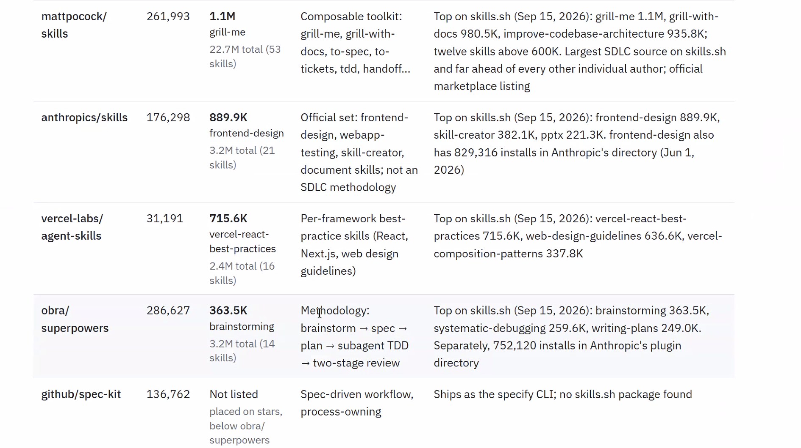

# AI For Teams - Reviewing Joakim/David Class

**Date:** October 17, 2026
**Time:** 11:00 AM - 12:30 PM
**Duration:** 90 minutes

## Overview

Review session examining Joakim and David's AI for Teams class materials and approach.

## People

| Name               | LinkedIn                                                                            | Notes            |
|--------------------|-------------------------------------------------------------------------------------|------------------|
| Ja'Mesa Dixon      | [linkedin.com/in/jamesa-dixon](https://www.linkedin.com/in/jamesa-dixon)            |                  |
| Joakim Marner      | [linkedin.com/in/joakimmarner](https://www.linkedin.com/in/joakimmarner/)           | Class instructor |
| Robert Gangasarran | [linkedin.com/in/robertgangasarran](https://www.linkedin.com/in/robertgangasarran/) |                  |
| David Bulkin       | [linkedin.com/in/davidbulkin](https://www.linkedin.com/in/davidbulkin/)             | Class instructor |
| Greg Keegan        | [linkedin.com/in/gkeegan](https://www.linkedin.com/in/gkeegan/)                     |                  |

## People Notes

### Joakim Marner

- Interested in pushing through material
- Anti-invitation for participation
- Defended material instead of listening to feedback
- Interest area: PR bottleneck -- using old, broken PR paradigm at higher speed, automated to be stupid faster

### David Bulkin

- Personable and playful
- Wants some class to work
- Has broad background to bring to bear
- Not focused on what this course should look like

### Ja'Mesa Dixon

- Asked pointed product/marketing questions
- Received deferral and defense (how Joakim thinks it should be) instead of acknowledgment that audience is confused about target audience, expected outcome, and how to address technical assumptions
- Interest area: decision-making applications of AI

### Greg Keegan

- Currently in 3-month boot camp
- Interest area: validation aspects of AI; OmniView
- Very mature vision of industry, current position of market vis-à-vis agile adoption
- Has spoken to senior folks at large organizations: Pfizer, AmEx
- Observed new titles emerging: AI Strategist, AI Enabler
- **Key contact -- definitely follow up with Greg**
- Previous experience: worked with Koch Industries in Atlanta (not interested in paying)
- Market readiness snapshot: Banking onboard with AI; healthcare next; hospitality already there (Airbnb)

## Session Notes

Popular skills repositories overview (Sep 15, 2026):

- **mattpocock/skills** (261,993 ⭐) -- Largest SDLC source on skills.sh; composable toolkit with grill-me (1.1M), grill-with-docs (980.5K), improve-codebase-architecture (935.8K); 53 skills total, 22.7M aggregate downloads
- **anthropics/skills** (176,298 ⭐) -- Official Anthropic set; frontend-design (889.9K) is top metric; 21 skills, 3.2M total downloads; 829,316 installs in Anthropic's plugin directory
- **vercel-labs/agent-skills** (31,191 ⭐) -- Per-framework best-practices; vercel-react-best-practices (715.6K); 16 skills, 2.4M total downloads
- **obra/superpowers** (286,627 ⭐) -- Methodology-focused; brainstorm → spec → plan → subagent TDD → two-stage review; 14 skills, 3.2M downloads plus 752,120 Anthropic plugin installs
- **github/spec-kit** (136,762 ⭐) -- Spec-driven workflow tool; ships as specify CLI; not on skills.sh

## Follow-up

- [ ]
