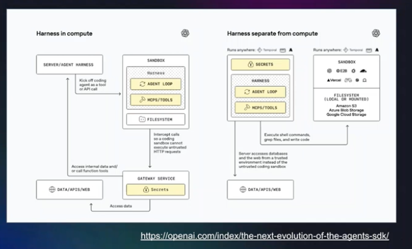

# Research: OpenAI Agents SDK, "The next evolution of the Agents SDK"

Back to [research.md](../research.md). Session: [15:15 Cornelia Davis](../session_notes.md#1515---your-agent-just-wrote-a-tool--and-ran-it-you-need-more-than-a-sandbox---cornelia-davis). Diagram from the 15:43 notes:

## APA citation

OpenAI. (2026, April 15). *The next evolution of the Agents SDK*. OpenAI. <https://openai.com/index/the-next-evolution-of-the-agents-sdk/>

The author and date are from secondary reporting (TechCrunch and others), since the post itself returned HTTP 403 when fetched.

## Summary

The Agents SDK adds sandboxed execution, so agents run in isolated environments where they can read files, run commands, and edit code. A model-native harness separates the agent loop and tools from the execution environment, with secrets held by a gateway rather than inside the sandbox. The features are generally available through the API at standard pricing, with Python first and TypeScript planned.

## Status

- The post itself was not retrieved, so this summary is not checked against its full text.
- The target of 10% of the post's word count can't be met without the text. Re-check once the post can be read.
- Sources disagree on framing: TechCrunch stresses compatibility with multiple sandbox providers, while The New Stack stresses sandboxed workspaces and durable execution.

## Sources

- [OpenAI, "The next evolution of the Agents SDK"](https://openai.com/index/the-next-evolution-of-the-agents-sdk/)
- [TechCrunch, April 15, 2026](https://techcrunch.com/2026/04/15/openai-updates-its-agents-sdk-to-help-enterprises-build-safer-more-capable-agents/)
- [DevOps.com, OpenAI upgrades its Agents SDK](https://devops.com/openai-upgrades-its-agents-sdk-with-sandboxing-and-a-new-model-harness/)
- [Toolhalla, OpenAI Agents SDK April 2026](https://toolhalla.ai/blog/openai-agents-sdk-april-2026-sandbox-and-harness-explained)
- [Gigazine, April 16, 2026](https://www.gigazine.net/gsc_news/en/20260416-openai-agent-sdk)
