# Session Notes

## 09:20 - Building a software factory you can trust. - Guy Podjarny

09:21:04 - Is this the best model for this task? I don't need lots of thinking... just capture notes. Prompt with "Next session note?..."

09:21:44 - 

09:21:53 - 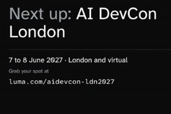

## 09:22 - Announcements - Simon Maple

09:23:09 - 9:22 - "Introduce my boss -- Guy Po". Founder of Tessl. Previously snyk. Previously Blaze. Guy Podjarny.

09:23:51 - That was Simon doing announcements.

09:24:34 - Is there a better format for capturing my notes as though it is a livestream? If so do that. But for now.... stage and commit with message "Beginning of Keynote - Guy Po"

09:26:02 - 

09:26:43 - Concerns: Quality (is it slop). Cost (will it cost a fortune). Safety (will it break things)

09:26:58 - Try commit again

09:27:15 - fix it

09:27:27 - stage and commit

09:29:26 - Factories are like work as we know it.... Skills. Loops. Factory. -- Trust is important. Getting one you can understand is better. Skills. Triggers. Compose.

09:32:16 - Stages. Skills. Tools. Context. Infrastructure (sandbox, telemetry. Automated vulnerability remediation. Black October. PHP2SHELL. LLMs on both sides. W/in 2 hours of disclosure, 100,000 attacks.

09:34:22 - Just Fix It -- works 26% fix (and no break) rate. Banks are worse. Need better process. Find -> Fix -> Verify fix -> Verify behavior -> Review -> Merge. Feedback loop on missing requirements. Tell the AI what you really wanted them to do.

09:35:14 - "Finds lots of vulnerabilities at an incredible cost" -- Major bank

09:39:10 - Verifiers - Trust (SKILL.md) but Verify

09:40:11 - If I add images here, timestamp them like a text note. 

09:41:00 - Self improving loops 

09:43:18 - Sponsors -- 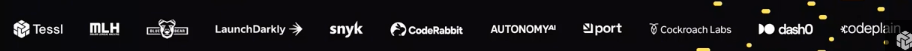

09:43:57 - Self-optomizing loops are critical, not add-on. Extract truth from observation. "What do you want for your birthday?" versus watch for a few years. Get truth first, then optomize. Keep them current. Maintenance.

09:44:14 - Factory is sum of skill + loops.

09:45:40 - Factory is 3 things: 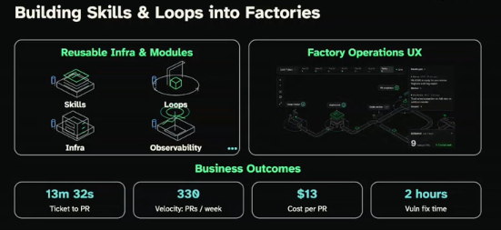 Reusable Infra & Modules. Factory Operations UX. Business Outcomes.

09:46:46 - "You are not building a factory. You are building a product.". Reminds me of Tesla "Build the X that builds the X". (Look up this quote from Elon Musk.

09:48:49 - Build the factory that builds the product.  Don't interactively fix the product. Fix the factory. <-- Guy. This feelsa lot like how I think.

09:52:19 - Buy vs Build . But "Embrace a partner because it delights you".

09:54:20 - Fun brag -- What Tessl delivered yesterday. Tickets -> PR. Where requirments? Where tickets? Kicks off loops. Factory floor view is exciting. Metrics build up. Pre-made loops (i.e. fixing vulnerabilities). "Get a little bit of delight".

09:55:22 - 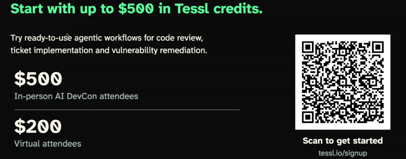

09:55:26 -  $500/in-person, $200/virtual.

09:55:44 - Summary: Skills -> Loops -> Factories. Lay back and let facgories do loops.

09:56:52 - stage, commit, push -- End of keynote. Simon leaves main stage.

Elon Musk quotes (OCR of [Image #7], a search-summary screenshot; not verified against the original sources):

- "The factory is the product." Musk formally tweeted this exact five-word phrase on Elon Musk's Official X Account in January 2021. (Source per screenshot: X post, unverified.)
- "We realized that the true problem... is building the machine that makes the machine. In other words, it's building the factory. I'm really thinking of the factory like a product." Musk explained this during a June 2016 Tesla press conference about the expansion of Gigafactory 1. (Source per screenshot: 2016 press conference, unverified.)

09:58:21 - [Image #7] -- And do OCR to add Elon quotes to end of Keynote (Guy Po) session. commit and push

10:04:20 - My take-aways from keynote. Build skills, loops, factories. It's how I've always worked. Learn. Play/experiment. Notice patterns. Optomize automatable parts. Scale (if needed). 2) Factory is the product. Feels like how I process data munging. Focus on the filters, automate them, rerun when they chage. Don't change data. Change filters.

## 10:05 - Context != Context: One Window, Different Lifecycles - Birgitta Boeckeler

10:05:51 - Start Brigita Beckler - Deeper cut on context engineering. It's 10:05. Readjust session_notes headers to get the right speaker and title. Future notes go in the 10:05 session of @session_notes.md

10:06:40 - 

10:07:12 - 

10:07:51 - stage. commit. "Correct the main stage agenda" is good starter message.

10:08:06 - 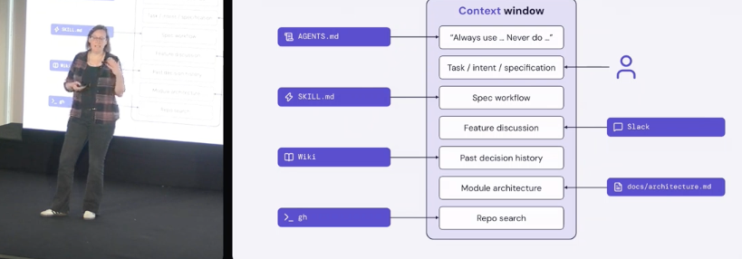

10:08:41 - Different colored 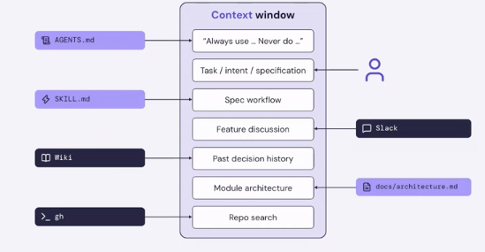

10:09:03 - 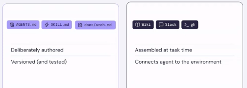

10:10:33 - Purple is deliberate. Black is ephemeral. Both are context. LHS is reusable - conventions, norms. RHS - custom, volitile.

10:10:51 - LHS Codified. RHS Ambient.

10:13:58 - 

10:14:31 - somebody dew-bwah.

10:15:52 - To evaluate and observe, we need to know what good looks like. Quote ACM article. Forsgren. 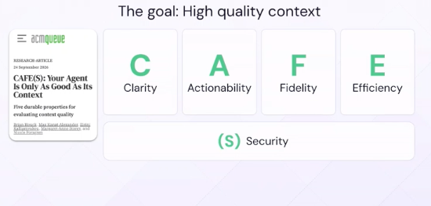 Clarity. Actionability. Fidelity. Efficiency. Security.

10:17:37 - We're doing this now via MCP servers.

10:18:52 - open the *.app link so I can see the main stage list of speakers and times

10:19:29 - Recently moved to Canada to join "Unblocked" company. 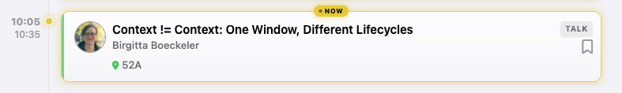

10:20:34 - Add. Do not correct or modify. I'll make it consistent tomorrow.

10:21:03 - Add <https://www.linkedin.com/in/birgittaboeckeler/> to Birgitta Boeckler in the people table.

10:21:11 - <https://www.linkedin.com/in/birgittaboeckeler/>

10:22:57 - What are gold documents? What are gold answers?

10:24:23 - Agent is answering my questins. It should be LOGGING my comments. How to flip/flop between logging mode and interaction mode?

10:26:09 - Stay in log mode. Fuck the /log/chat custom shit.

10:26:17 - Stay in log mode. Fuck the /log/chat custom shit.

10:27:31 - Take-away -- This is classical meta-cognition. Thinking about thinking. What do systems know? How can they act? How do they interact. Think. Learn. Tune it.

10:29:04 - How to deliver *ambient* content? Some say it's hard. But it's engineering broken down to small pieces.

10:30:40 - Add guidance to CLAUDE.md for a note-taking feature that logs user text with timestamp but does not submit it to claude as a prompt. Suggest a way for a new agent to take this role.

10:31:14 - Add guidance to CLAUDE.md for a note-taking feature that logs user text with timestamp but does not submit it to claude as a prompt. Suggest a way for a new agent to take this role.

10:32:44 - What does this mean? [Image #1]

10:33:16 - What should we do. Ask questions. Think outloud. Maybe in slack so agent and people can BOTH see it.

10:33:20 - What does this mean? [Image #1]

10:33:50 - I'm stuck in a loop. How to prevent this? [Image #2]

10:34:01 - I'm stuck in a loop. How to prevent this? [Image #2]

## 10:35 - ☕ Coffee Break

10:53:44 - We are on a break.  It is 10:53.

11:00:55 - We are still on a coffee break

## 11:05 - Models Alone Aren't Enough: Engineering Context as a Graph for Human + Agent Teams - Alan Braun

11:08:23 - 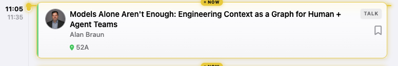

11:12:14 - Work is a team sport.

11:13:20 - Working team-to-team is difficult.  Now we're doing team-to-agent.  Agent-to-agent.  How to build context for all?[Image #1]

11:15:19 - Code building was long pole in the tent. Plan and Review where short.  Execute is shorter.  Are we releasing faster?  :-)  What silent "tax" is being added?  Lots more review!  Optomize Plan/Execute/Review should optomize for all stages, not just execute.

11:16:11 - [Image #2] [Image #3]

11:17:15 - We'll shorten iff we cut review.  Get faster delivery, not just faster execution.

11:19:41 - Context stack.  Since execution is shorter, we can spend more time up front on specs.  [Image #4]  The **org-wide** context gives a big payback (especilly for product guy).  Seems easy at Jira work item.  (Will he point to Jira Align to show higher connection?)  Misconnections (e.g. marketing/dev not shared).

11:20:53 - [Image #5]  Product hype.  20 years of learning how people/teams/orgs really operate.  [Image #6]

11:21:09 - <https://www.youtube.com/live/kPB9y6ZWXxk>

11:26:04 - MCP connectors are helpful to get the right info.  Time for a video.  Claude (LHS without context.  With context.)  [Image #7]

11:27:14 - [Image #8]

11:28:28 - TWG - Teamwork Graph?

11:32:05 - With TWG, up front context gathering starts slower, but eventually it gets better answer at smaller cost.  48% less tokens.  44% better answers.[Image #9]

11:33:38 - Old school.   Write out inputs, outputs, have blind LLM be the judge.

11:34:55 - 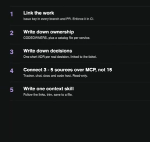

11:35:31 - More context is not better.  Connected context IS.

11:42:44 - Next session is Aidan.  We're on break.

## 11:45 - Building When Code is Cheap and Your Time is Not - Aidan Cunniffe

11:46:50 - Aiden started git.ai at this conference.  OpenAI bought it 1 month ago.  TY to all who picked up project.

11:46:50 - 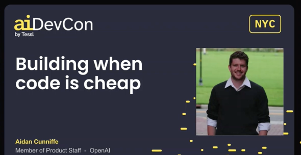

11:47:02 - 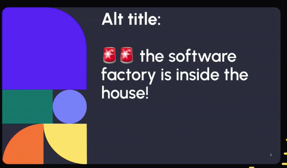

11:47:12 - 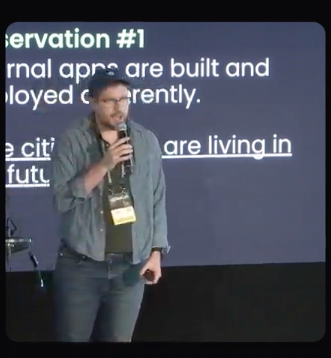

11:47:29 - Citizen devs are living in the future.

11:48:04 - Auth is outside the app (at another layer).

11:49:14 - Cloud Agent + Dev Environments  != OOTB (Out Of THe Box) Factory

11:49:14 - 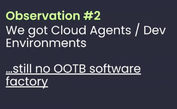

11:49:27 - 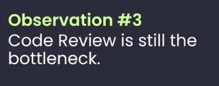

11:40:55 - 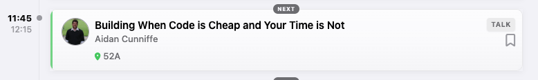

11:51:15 - Step back.  What is goal of SW Factory?  (He talks to lots of CTOs)  Follow-up.

11:51:45 -- Goals.   F/U - Review this!!!

11:51:45 - 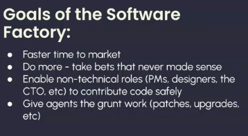

11:52:27 - LHS done.  RHS needs work.  HOW is being built.  WHAT could use some attention (i.e. opportunity)

11:52:27 - 

11:52:59 - Refactoring got cheaper.  Abstractions got cheaper.

11:53:54 - He's building the library first.  Design-first development.  This gets faster time to market.

11:54:45 - Take more (smaller) bets --

11:54:45 - 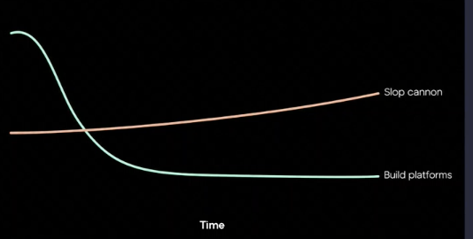

11:55:48 - Big Tech built platforms -

11:55:48 - 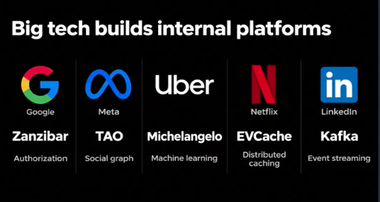

11:59:42 - Enable non-technical roles to contribute code.

12:02:00 - Amazon's 2002 API mandate.  ... or you will be fired.   Didn't have time to do it then.  THinks it will become way of working.

12:02:27 - Maybe factory is the interfaces we've been making along the way.

12:02:34 - TODO - git.ai

12:03:52 - <https://www.linkedin.com/in/acunniffe/>

12:05:47 - Takeaway - Citizen deveoper is living in the future.  Look for ways to support them.

## 12:25 - Building a harness that keeps up with the latest models - Nicolas Carmont Zaragoza

12:27:13 - [Image #1]

12:27:43 - [Image #2]

12:28:05 - [Image #3]

12:29:31 - Not taking is broken.

12:31:13 - Notes are working for text.

12:31:31 - 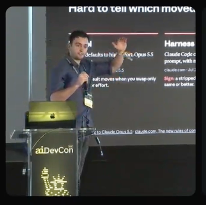

12:32:13 - 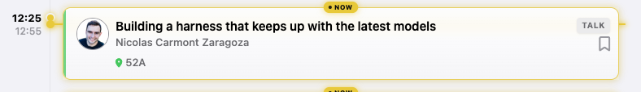

12:35:55 - Problem -- Verify was mentioned all over the place.  Opus starts focusing on verification.  Makes old guidance to be duplicated now.  Makes iti cheaper once de-duped.

12:37:29 - As models advance, old habits are inhibiting.  Bit rot is faster.  It's about harness, not the code itself.

12:38:48 - Model bakes in best practices.  Can prune to 20% of previous prompt.  Manager should say WHAT and let employee do HOW.  Unharness!

12:40:45 - Verbosity increases contradictions.  KISS.  Transcripts are wasted on which to obey (e.g. running full tests).  CLAUDE.md and AGENT.md files can be (surprisingly) lean.

12:41:00 - ![Slide titled "02 · Un-harnessing" reading "Six published changes. All of them: simplify." with a table of six rows, each crossing out an old practice and replacing it: explicit rules for every case to let the model use its judgement, examples of how to use tools to design the tools and interfaces, load all context up front to load context when needed, explicit verification instructions to remove them since the model self-checks, "Think carefully" in a chat system prompt to let effort control thinking, and keep last model's effort setting to re-sweep effort per model](images/photos_20261103-124100.png)

12:41:33 - Examples may be helpful.  They may also be biasing.

12:45:30 - Add loop to prune.  Like refactoring.  Get it right; get it small.   Look for "/goal"

12:45:30 - 

12:46:38 - "We are in an era where intelligance scales".

12:46:38 - 

12:47:24 - Outcomes, not steps.

12:47:38 - Read the transcripts.  Models vent when goal is impossible.

12:48:15 - ![Slide titled "03 · The loop · Worked example" reading "Opus 5 → Opus 5.5" with a note that existing Claude Opus 5 prompts should perform well without changes, so the list is optional tuning. A Remove panel lists "Remove instructions that stood in for thinking", "Think carefully" lines in chat system prompts, and scaffolding for visual inputs if a re-test shows you no longer need it. An Add panel lists a checklist the model updates on long runs, a time budget for multi-agent work if you can estimate one, and enough max_tokens for thinking and the reply](images/photos_20261103-124815.png)

12:50:16 - 1. How would you test correctness after removing 80% of prompt (like Claude did).  3 - Adding ability to vent was helpful (by reading transcripts)

12:50:16 - 

12:51:24 - Takeaway - POV (scientist vs engineering).  Look at what to take away, not just what to add.

12:54:57 - Take away - There is a job for moving from model to model.

## 12:55 - 🥪 Lunch

12:56:12 - Traits of engineer and scientist.  Engineering (optomize for X).  When you remove 80%, you have to think differently.  Engineer develops by hand.  Scientist looks to outcomes.

12:57:23 - 61 watching at lunch break.

13:16:07 - We're on lunch break.

13:20:06 - So far... nobody I'm dying to talk to.  That's a signal.  Glad I didn't get up at 4:00 to catch a train to be in the room.  Working on 2 monitors with 2 AI's helping is a good practice.

## 13:55 - Security in GitHub Agentic Workflows - Landon Cox

14:07:10 - 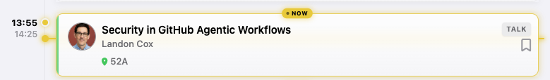

14:07:36 - Let slop into the repo, then spend tech debt budget to get it out.  Cheaper than keeping it out.

14:11:21 - 

14:12:25 - If agents go off rails: 1) Cannot expose secrets.  3) Agents are read-only.  Writes are buffered then audited later.

14:15:02 - Invested lots of time for logging and observability.  Inputs.  Agent calls.  Network firewall.  Token spend.....  Good for debugging and token optomizing.  All inputs (prompts, skills, etc...) are technical debt (AKA technical TODO that can be invested or ignored).

14:17:20 - Safe outputs -> Filter by policy -> Apply writes

14:17:42 - TODO - REview gh.io they are an open source platform.

14:20:59 - TODO - Quick look around gh.io.  Connect with Landon Cox.

14:27:04 - "We are active online.  Best way to interact is via issues."

14:27:18 - gh.io/gh-aw

14:29:33 - TODO: Note to Landan Cox -- What do you learn by watching what your "safe outputs" try to change that's rejected by the filter policy?

## 14:35 - An Architectural Approach to Regenerative Software - Chad Fowler

14:37:43 - 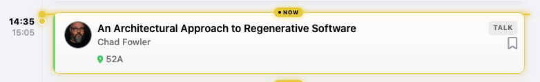

14:37:43 - It's 2:37.  New talk.  Chad Fowler.  Ruby.  Gems.  Is writing book for O'Reilly on regenerative software.

14:39:31 - How to write code now.  No code review.  Nobody writes prompt.  Coding never stops.  Language and stack are chosen by not-people.  Write the spec later.  To learn, remove code.  Discard code.  Keep decisions.

14:39:31 - 

14:39:31 - 

14:40:44 - How do we buid systems that survive?   He was a software euthenazer.  He killed big systems.  Immutable infrastructure and disposable code.  Code is an artifact (not a source).

14:41:54 - TODO - Followup.  Code is no longer source.

14:44:08 - Story: Heartbled bug.  Servers were already disposable.  Don't mutate a server.  Reconfig and regenerate.  80+ servers  This is what we'd been training for.  Servers didn't live longer than an hour.  Used to work on wunderlist.

14:45:05 - Simple change (tiny schema change) took 48 hours.  But the related stuff took a bigger toll.

14:45:52 - XP did not remove rigor.  It improved feedback for learning and time to adjust.

14:45:52 - 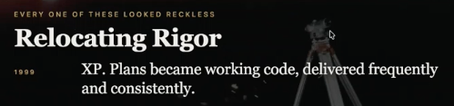

14:46:44 - Checks move from typechecks elsewhere.

14:46:44 - 

14:48:19 - Burn the code.  What to keep?  1) Intent.  2) Architecture.  3) Eval (How we know a replacement is right).  Intents.  Code? 4) Provenance.

14:48:19 - 

14:48:53 - He used granola to capture notes from meeting.

14:49:30 - Can you 'rm -rf src'?  How bad would that be?  WHat remains?  Humans?  What is missing to rereatte is QUICKLY?

14:50:33 - Architectural decisions are actually tech work-arounds.  Architecture is an accident.  It felt like architecture.  Was actually accident of evolution.  What is critical to keep.

14:50:58 - 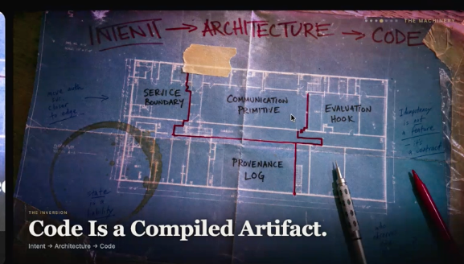

14:51:10 - 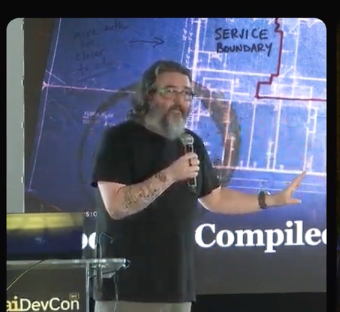

14:52:01 - Intent => Architecture => Code.   Compiling to an architecture.  Could you abandon PHP or npm and regenerate elsewhere?

14:59:40 - Specs should not be Google Docs.  Should be colleciton of assertions (graph database).  Ask Gini to generate the document from that graph.

14:59:40 - 

14:59:40 - Conversation & Docs -> Clauses -> Canonical nodes -> Implementation unit -> Generated code -> Evidence & Production -> Conversation & Docs.  There is a PoC (Proof of Concept).  Lines trace back to clauses.  This is how I was thinking about new requirements capture at HillRom.  Evaluations survive rewrites.  No need to do that in past.  Can do that now.

15:00:56 - TODO - Look at phoenix thing.  Find the canonicalizer.  Trace "requirements change" to the "code change".  Can regenerate into another target architecture.  Phoenix will redeploy.

15:02:35 - TODO: F/U Tribal Knowledge.  Documented in the code.  Documented in the culture.  Followup posting on LinkedIn.

15:02:35 - 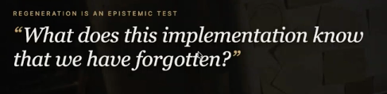

15:03:45 - Pace differs at different layers.  Time scales.  Ant talking to mountain.

15:03:45 - 

15:04:55 - Delete Safely.  Then Compact.  Rewrites inject ideas.  That becomes cruft.  Delete concepts.  (Aside... opposite of earlier topic).

15:04:55 - 

15:05:12 - 

15:05:47 - Selective -- tracability allows back/forth

15:06:47 - System is asset.  Code is liability.

15:06:47 - 

15:07:01 - Read long version in "Regenerative Systems".

## 15:15 - Your Agent Just Wrote a Tool--and Ran It. You Need More than a Sandbox. - Cornelia Davis

15:16:09 - 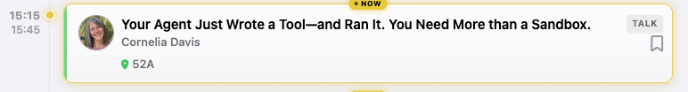

15:16:22 - Temporal is wicked cool, but not going to talk about it today.

15:16:57 - You need more than a sandbox.

15:16:57 - 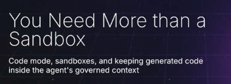

15:17:10 - 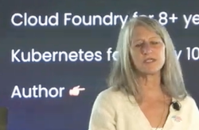

15:17:20 - 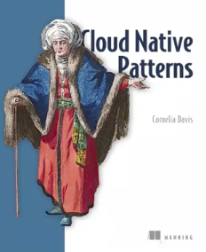

15:19:52 - There used to be ceremony post-creation.  No PRs.  No checkpoints.  Check it immediately IN PRODUCTION.

15:19:52 - ![Slide titled "The Risk" with the heading "Agents that choose their own path" and five warnings: the execution is determined at runtime by the model, no pull request, no pipeline, no human checkpoint; inputs to the code writing are untrusted, any page, email or ticket the agent reads can carry instructions, prompt injection; the generated code is not the harness, the harness brings guardrails, including around tools, what happens when the harness isn't calling the tool?; the lethal trifecta, private data, plus untrusted content, plus a way to send data out; mistakes move at machine speed, one bad decision can repeat across hundreds of actions before anyone looks](images/photos_20261103-151952.png)

15:20:31 - 3 orders of magnitude time to exploit (from day0) post/pre agentic modes

15:21:26 - "Code Mode" allows agents to build their own tools.  Model builds program that does 10,000s of calls.

15:22:20 - sandbox constrains WHERE code runs, not what code can DO.

15:22:41 - 

15:23:06 - 

15:24:58 - 

15:26:33 - 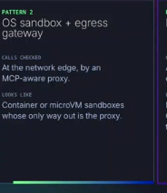

15:31:54 - Will use pydantic monte.  Sandbox that's constrained.  Not OS sandbox.  Completely constrained.  Python only.

15:32:08 - I glazed over.  Checked out.  Too many details, or too late in the day?

15:40:05 - One of most important to control is to log.  Helps improvement.  Auditability.

15:40:31 - TODO - COnnect with Cornelia.  Research CEO Amar Abbas.

15:41:12 - TODO:  She wrote Policies in "Dogood" and "Cedar".  Research these.

15:42:40 - Policy is based on context of whole convesation, not just a short piece.

15:43:12 - ![Two-panel diagram titled "Harness in compute" and "Harness separate from compute." The left shows a server or agent harness kicking off a coding agent into a sandbox containing an agent loop, MCPs/tools, and a filesystem, with a gateway service holding secrets that intercepts calls. The right shows secrets, an agent loop, and MCPs/tools running anywhere, with the sandbox and filesystem separate, and the server accessing databases and the web. Footer link: openai.com/index/the-next-evolution-of-the-agents-sdk](images/photos_20261103-154312.png)

15:43:46 - <https://openai.com/index/the-next-evolution-of-the-agents-sdk/>

## 15:45 - ☕ Coffee Break

15:45:56 - Follow-up.  Yes we are hiring at Temporal.

15:47:23 - Followup - Thank her for high energy demo.  Props for doing it live.  Have a great time in Hawaii.

15:50:26 - <https://www.linkedin.com/company/temporal-technologies/> is hiring.

## 16:15 - Scaling Agentic Engineering at Zalando - Bartosz Ocytko

## 17:00 - The Future of AI-Powered Factories - Steve Yegge
