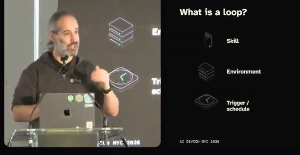
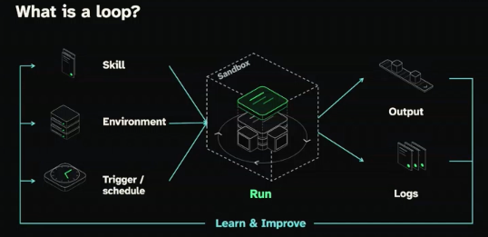
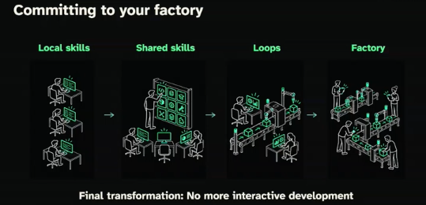
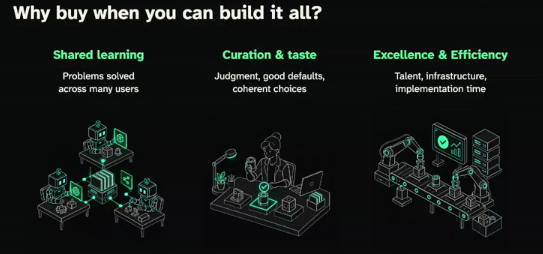
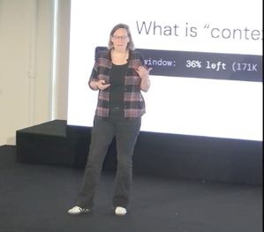

# Session Notes

## 09:20 - Building a software factory you can trust. - Guy Podjarny

09:21:04 - Is this the best model for this task? I don't need lots of thinking... just capture notes. Prompt with "Next session note?..."

09:21:44 - [Image #1]

09:21:53 - [Image #3]

## 09:22 - Announcements - Simon Maple

09:23:09 - 9:22 - "Introduce my boss -- Guy Po". Founder of Tessl. Previously snyk. Previously Blaze. Guy Podjarny.

09:23:51 - That was Simon doing announcements.

09:24:34 - Is there a better format for capturing my notes as though it is a livestream? If so do that. But for now.... stage and commit with message "Beginning of Keynote - Guy Po"

09:26:02 - [Image #4]

09:26:43 - Concerns: Quality (is it slop). Cost (will it cost a fortune). Safety (will it break things)

09:26:58 - Try commit again

09:27:15 - fix it

09:27:27 - stage and commit

09:29:26 - Factories are like work as we know it.... Skills. Loops. Factory. -- Trust is important. Getting one you can understand is better. Skills. Triggers. Compose.

09:32:16 - Stages. Skills. Tools. Context. Infrastructure (sandbox, telemetry. Automated vulnerability remediation. Black October. PHP2SHELL. LLMs on both sides. W/in 2 hours of disclosure, 100,000 attacks.

09:34:22 - Just Fix It -- works 26% fix (and no break) rate. Banks are worse. Need better process. Find -> Fix -> Verify fix -> Verify behavior -> Review -> Merge. Feedback loop on missing requirements. Tell the AI what you really wanted them to do.

09:35:14 - "Finds lots of vulnerabilities at an incredible cost" -- Major bank

09:39:10 - Verifiers - Trust (SKILL.md) but Verify

09:40:11 - If I add images here, timestamp them like a text note. 

09:41:00 - Self improving loops 

09:43:18 - Sponsors -- [Image #5]

09:43:57 - Self-optomizing loops are critical, not add-on. Extract truth from observation. "What do you want for your birthday?" versus watch for a few years. Get truth first, then optomize. Keep them current. Maintenance.

09:44:14 - Factory is sum of skill + loops.

09:45:40 - Factory is 3 things:  Reusable Infra & Modules. Factory Operations UX. Business Outcomes.

09:46:46 - "You are not building a factory. You are building a product.". Reminds me of Tesla "Build the X that builds the X". (Look up this quote from Elon Musk.

09:48:49 - Build the factory that builds the product.  Don't interactively fix the product. Fix the factory. <-- Guy. This feelsa lot like how I think.

09:52:19 - Buy vs Build . But "Embrace a partner because it delights you".

09:54:20 - Fun brag -- What Tessl delivered yesterday. Tickets -> PR. Where requirments? Where tickets? Kicks off loops. Factory floor view is exciting. Metrics build up. Pre-made loops (i.e. fixing vulnerabilities). "Get a little bit of delight".

09:55:22 - [Image #6]

09:55:26 -  $500/in-person, $200/virtual.

09:55:44 - Summary: Skills -> Loops -> Factories. Lay back and let facgories do loops.

09:56:52 - stage, commit, push -- End of keynote. Simon leaves main stage.

Elon Musk quotes (OCR of [Image #7], a search-summary screenshot; not verified against the original sources):

- "The factory is the product." Musk formally tweeted this exact five-word phrase on Elon Musk's Official X Account in January 2021. (Source per screenshot: X post, unverified.)
- "We realized that the true problem... is building the machine that makes the machine. In other words, it's building the factory. I'm really thinking of the factory like a product." Musk explained this during a June 2016 Tesla press conference about the expansion of Gigafactory 1. (Source per screenshot: 2016 press conference, unverified.)

09:58:21 - [Image #7] -- And do OCR to add Elon quotes to end of Keynote (Guy Po) session. commit and push

10:04:20 - My take-aways from keynote. Build skills, loops, factories. It's how I've always worked. Learn. Play/experiment. Notice patterns. Optomize automatable parts. Scale (if needed). 2) Factory is the product. Feels like how I process data munging. Focus on the filters, automate them, rerun when they chage. Don't change data. Change filters.

## 10:05 - Context != Context: One Window, Different Lifecycles - Birgitta Boeckeler

10:05:51 - Start Brigita Beckler - Deeper cut on context engineering. It's 10:05. Readjust session_notes headers to get the right speaker and title. Future notes go in the 10:05 session of @session_notes.md

10:06:40 - 

10:07:12 - 

10:07:51 - stage. commit. "Correct the main stage agenda" is good starter message.

## 11:05 - Models Alone Aren't Enough: Engineering Context as a Graph for Human + Agent Teams - Alan Braun

## 11:45 - Building When Code is Cheap and Your Time is Not - Aidan Cunniffe

## 12:25 - Building a harness that keeps up with the latest models - Nicolas Carmont Zaragoza

## 13:55 - Security in GitHub Agentic Workflows - Landon Cox

## 14:35 - An Architectural Approach to Regenerative Software - Chad Fowler

## 15:15 - Your Agent Just Wrote a Tool--and Ran It. You Need More than a Sandbox. - Cornelia Davis

## 16:15 - Scaling Agentic Engineering at Zalando - Bartosz Ocytko

## 17:00 - The Future of AI-Powered Factories - Steve Yegge
