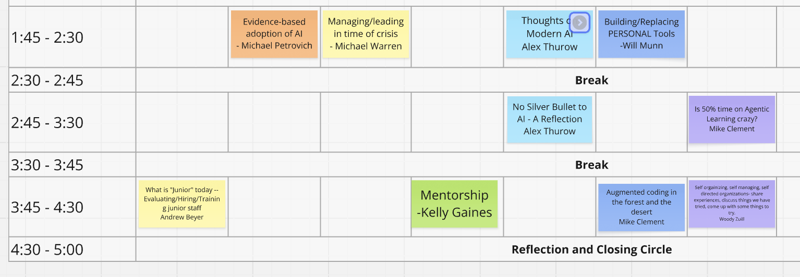
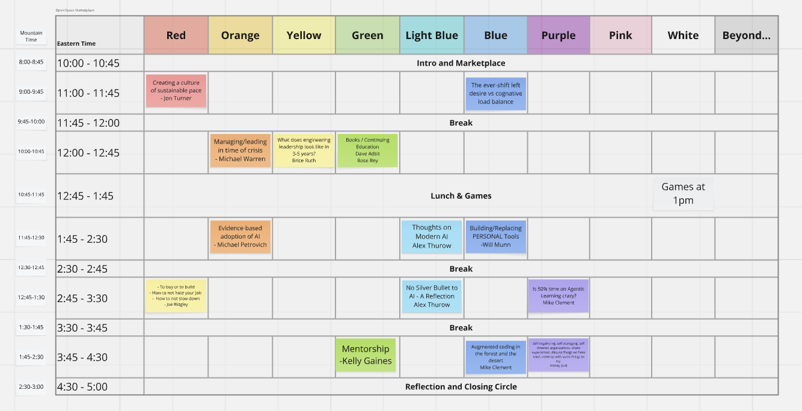

# Schedule

Times are Eastern. Format: `HH:MM - Color - Speaker - Title`. The newest schedule image is the source of truth.

**Bold** = attended, with follow-ups done in `session_summary_and_followup.md`.

13:32:53 - 

11:07:56 - 

10:00 - All tracks - no speaker listed - Intro and Marketplace

**11:00 - Red - Jon Turner** - Creating a culture of sustainable pace

11:00 - Blue - no speaker listed - The ever-shift left desire vs cognative load balance

11:45 - All tracks - no speaker listed - Break

12:00 - Yellow - Brice Ruth - What does engineering leadership look like in 3-5 years?

**12:00 - Green - Dave Adsit, Rose Rey** - Books / Continuing Education

12:45 - All tracks - no speaker listed - Lunch & Games (Games at 1pm in White)

13:45 - Orange - Michael Petrovich - Evidence-based adoption of AI

13:45 - Yellow - Michael Warren - Managing/leading in time of crisis

13:45 - Light Blue - Alex Thurow - Thoughts on Modern AI

13:45 - Blue - Will Munn - Building/Replacing PERSONAL Tools

14:30 - All tracks - no speaker listed - Break

14:45 - Light Blue - Alex Thurow - No Silver Bullet to AI - A Reflection

14:45 - Purple - Mike Clement - Is 50% time on Agentic Learning crazy?

15:30 - All tracks - no speaker listed - Break

15:45 - Red - Andrew Beyer - What is "Junior" today -- Evaluating/Hiring/Training junior staff

15:45 - Green - Kelly Gaines - Mentorship

15:45 - Blue - Mike Clement - Augmented coding in the forest and the desert

15:45 - Purple - Woody Zuill - Self organizing, self managing, self directed organizations - share experiences, discuss things we have tried, come up with some things to try

16:30 - All tracks - no speaker listed - Reflection and Closing Circle

Grid: <https://app.gather.town/app/5GMBVJOcKR5UhiT7/EL%20Summit>
