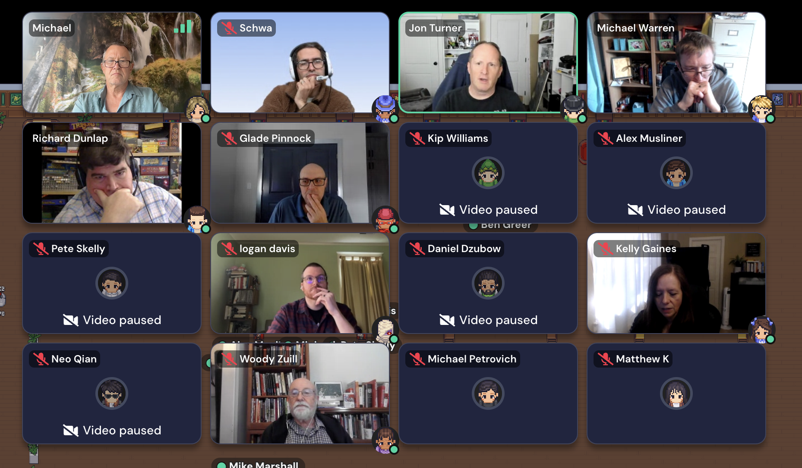
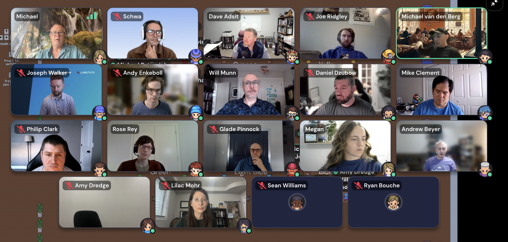
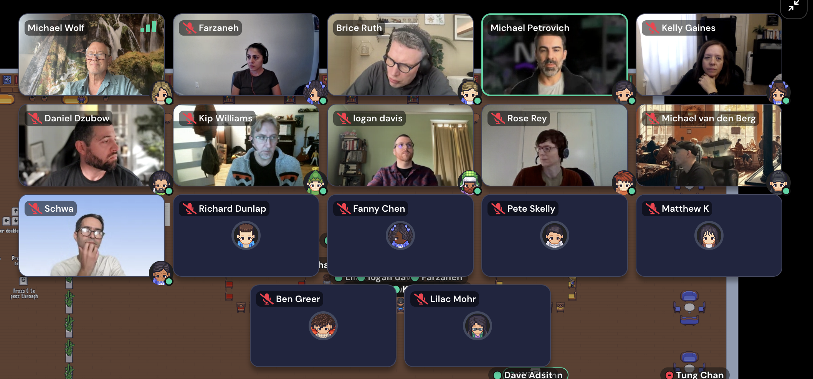
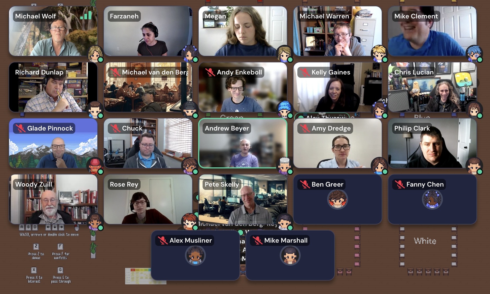
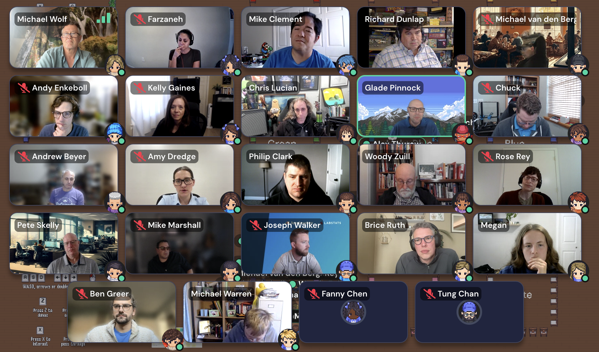
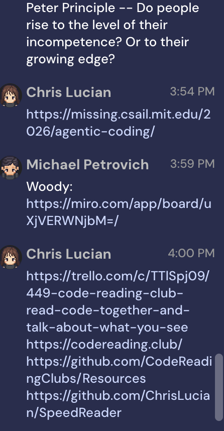

# Session Notes

Schedule: [schedule.md](schedule.md)

## 10:00 - All tracks - no speaker listed

Intro and Marketplace

## 11:00 - Red - Jon Turner

Creating a culture of sustainable pace

11:02:21 - 

Names on the grid: Michael, Schwa, Jon Turner, Michael Warren, Richard Dunlap, Glade Pinnock, Kip Williams, Alex Musliner, Pete Skelly, logan davis, Daniel Dzubow, Kelly Gaines, Neo Qian, Woody Zuill, Michael Petrovich, and Matthew K. Partly visible labels at the edges: Ben Greer and Mike Marshall.

## 11:00 - Blue - no speaker listed

The ever-shift left desire vs cognative load balance

11:09:23 - 11:06 - I moved from Red to Blue session.

11:10:27 - 

Names on the grid: Michael, Schwa, Dave Adsit, Joe Ridgley, Michael van den Berg, Joseph Walker, Andy Enkeboll, Will Munn, Daniel Dzubow, Mike Clement, Philip Clark, Rose Rey, Glade Pinnock, Megan, Andrew Beyer, Amy Dredge, Lilac Mohr, Sean Williams, and Ryan Bouche.

11:13:50 - David Adsit - What is cargo cult of shift left?  Is there still a DBA?  Handoffs....  Shift left was attempt to address problem of handoff and context loss.  Embrace that there is always a bottleneck.

11:16:11 - Joseph Walker -- Has always been small group.  More hats, not more people/roles.

## 11:20 - Red - Jon Turner

Creating a culture of sustainable pace

11:20:49 - 11:20 Blue -> Red

11:33:59 - Michael Petrovich - There is no free lunch.

11:35:18 - Michael P - Set up for later talk.  What is the problem we're trying to solve.

11:39:38 - Alex Thurow - Culture of greed is multiplied by speed (of AI and old management practices)

11:39:43 - Schwa - Great concept -- Integrating at so many different time scales.

11:41:55 - logan davis - reference to 70s show.  We are swimming in whole new systems.  Ledgers.  Desks.  Phones.  -> Spreadsheets.  Zoom.

11:49:33 - Session ended in Red room.

## 12:00 - Green - Dave Adsit, Rose Rey

Books / Continuing Education

12:00:54 - What time is it.  I am going to green room.  What is the topic.  Start taking notes there.

12:04:22 - David Adsit - "Signals & Levers" interviewed authors yesterday as part of a book club.

12:05:38 - Megan - Likes spending time on one topic (regarding Dave Adsit).  Don't learn unless you give time to sink in.

12:06:53 - Matthew K (Matt Knowles) is an avid book club person.  Contact him.

12:10:05 - Kelly Gaines - Has learning ADD.  Deep voice.  FOMO of Mike's (?) book club?

12:14:36 - Michael Warren - In company that (still) has 10% days.  Read 1 paragraph per day.  Only 1 newsletter.

12:25:07 - What are you reading?   --versus-- What are you learning?  How are you learning?

12:25:13 - WHo is in book clubs.

12:25:29 - Dave Adsit - Mike Clement's group.  Readins necessary for entry.

12:25:42 - Lilac Mohr - Staff engineers.

12:26:55 - Rose Rey - Attends Ted Young's book club.  1 chapter / week.  Zoom.  Attrition over book.

12:28:27 - Jon Turner - Utah SW Craftsman.  Zoom.  1x/month.  1-2 chapter / meeting.  Breakout rooms if too large.

12:30:36 - Will Munn - Several book clubs over years.  Continuous learning group now.  "97 Things Every SW Architect Should Know".  Lean Coffee.

12:31:49 - Glade Pinnock - Idaho.

12:38:47 - Andy Enkeboll - Was a boot camp instructor.

12:40:02 - Kelly Gaines - 15-year old.  Active recall.

12:40:16 - Jon - Rose's rant about not passing along historical information.

12:41:11 - Jon - Megaman quotes.   Curating quotes through multiple levels.

12:43:03 - Dave Farley -

12:43:10 - Kent Beck's - TDD by example

12:43:21 - Fred Brooks

12:46:31 - Dave Adsit - Is in Engineering Leadership round table.

12:55:03 - Dav Adsit - Hiring lately

13:01:52 - David Adsit - Dabbles in economics & psychology.   Always building socio-technical system.

13:02:21 - Rose - "Crucial Conversations".  Because you are always dealing with people.

13:03:16 - "Drive" Daniel Pink

13:04:41 - Rose Rey - Follow up to connect.

13:05:45 - Michael Warren - Streaking.  Goals.  Track small behaviors.  What we do builds who we are.

13:06:03 - Michael Petrovich - Curios.  What changed your understanding so deeply.

13:14:11 - Michael P - Statistical Process Control.  Deming.  Variation (routine, non-routine).  Measure/understand first.  Outside confidence band.  Unexpected.  Use these to learn how to make more predictable.  If it's way out of band, cannot inflect that without changing the process.

13:15:02 - Michael P - Great smile.  Year-over-Year values.  Compare ranges instead of values.

13:16:06 - Improve system.  Distort system.  DIstort data.

## 13:45 - Orange - Michael Petrovich

Evidence-based adoption of AI

13:48:09 - Orange - Evidence-based adoption of AI - Michael Petrovich.  Starting to take notes.

13:48:43 - What problem are we trying to solve?  Not just proximate.  Underlying.  How do we know that?  What can we observe?

13:49:13 - 

Names on the grid: Michael Wolf, Farzaneh, Brice Ruth, Michael Petrovich, Kelly Gaines, Daniel Dzubow, Kip Williams, logan davis, Rose Rey, Michael van den Berg, Schwa, Richard Dunlap, Fanny Chen, Pete Skelly, Matthew K, Ben Greer, and Lilac Mohr. Partly visible labels at the bottom edge: Dave Adsit and Tung Chan.

13:50:53 - Historical - Inexperience operator.  Uses it for eerything.  Experienced operator uses it for certain problems.  (pause) run experiment < backtrack > how will we know it is accepted?  Did it change (better worse)?

13:51:27 - <https://www.linkedin.com/in/mpetrovich/>

13:51:43 - <https://www.linkedin.com/in/alexthurow/>

13:53:47 - ThoughtWorks is evidence based approach.  DORA metrics.  Which tools are right in what areas.  There are more nuances.

13:53:58 - Q - Wehre is AI being put as solution without problem?

13:59:39 - Kelly - Back in the day.  Notepad.  IDE.  Refactoring tools.  Agentic tools.  Wants to get technology proficiency first.  Eperiment.  Trying to keep grounded.  Trying to understand higher level patterns.  Elevating the role.  Used to be writing a test was blocked by syntax.

14:04:11 - Brice Ruth - We have tools that we've already used that won't cost millions of tokens.

14:10:33 - Logan Davis - Had mechanical thiniing (ram, cpu).  Higher level now.  Abstraction.  Photography -- portrait artists out of business, now it's beyond cameras for portraits.

14:13:15 - Pete Skelly - Friction is helpful.

14:13:42 - Michael P - Thought experiemnt.   Rewind to 2020.  Before ChatGPT.  What were challenges were there then?

14:14:52 - Is AI now addressing them?

14:15:24 - Michael P was PM and EM now he's IC.

14:21:06 - Farzaneh - First Q.  Before AI.  Lack of documentyation.  Tribal knowledge.  Bottleneck -- complete across board maturity.  PRs.  Unit tests.  Gaps.  But... are we shipping more frequently or more outcomes.  Seemed like Michael P knew them.

14:23:07 - Kelly  - Moving beyond copy/paste of stack overflow.  But similar trust-based reuse.

14:25:53 - Farzaneh - Limited tokens.  Who is using too much or too little.

14:26:05 - Farzaneh seems to be know by Michael P

14:36:25 - Chris Lucian - _IS_ using DORA metrics.  Farzaneh will stop by later.  DSL (domain specific language) and DORA metrics.  4-5x/day release w/ AI.  DORA metrics are heading in right direction.  Using mutation testing (determenistic).  MTTR (Mean time to recovery) - cloud watch MCP server compares to what is in flow. 8 mobbing teams.  1/2 hour through pipeline.  Rewrites through non-pythonic names.

14:36:59 - Farzaneh - Asking about outcomes and customer-based metrics.  Chris does have them.

14:37:55 - Followup - Contact Chris Lucian

14:43:08 - Chris - Has optomized for serverless.  Some of the checks have been incorporated into determanistic testing.

14:43:46 - Continuing in Orange room even though other session is starting soon.

14:45:43 - Review commits.  Extract qualities of code.  Write future code similarly.  "Give me video of this feature working".  IoT.  Simulators of features working (or not).  Video proves that it had to write code, test it, understand it.

14:45:55 - Overnight dark factories.

## 14:45 - Purple - Mike Clement

Is 50% time on Agentic Learning crazy?

14:50:12 - 

Names on the grid: Michael Wolf, Farzaneh, Megan, Michael Warren, Mike Clement, Richard Dunlap, Michael van den Berg, Andy Enkeboll, Kelly Gaines, Chris Lucian, Glade Pinnock, Chuck, Andrew Beyer, Amy Dredge, Philip Clark, Woody Zuill, Rose Rey, Pete Skelly, Ben Greer, Fanny Chen, Alex Musliner, and Mike Marshall. Partly visible label at the middle: Alex Thurow.

14:54:52 - Mike Clement - Around the room -- WHat do you want from this session.

14:55:56 - Amy Dredge - Chris dropped 50% mandate for learning.  Maybe Amy is on Hunter team.

14:57:31 - Glade Pinnock - AI interruption has changed job interaction.  More siloed.  Step back from product to process.

14:57:56 - 

Names on the grid: Michael Wolf, Farzaneh, Mike Clement, Richard Dunlap, Michael van den Berg, Andy Enkeboll, Kelly Gaines, Chris Lucian, Glade Pinnock, Chuck, Andrew Beyer, Amy Dredge, Philip Clark, Woody Zuill, Rose Rey, Pete Skelly, Mike Marshall, Joseph Walker, Brice Ruth, Megan, Ben Greer, Michael Warren, Fanny Chen, and Tung Chan. Partly visible label at the middle: Alex Thurow.
15:01:02 - Chris Lucian - My ears are burning.

15:01:25 - Brice - What kinds of scaffolding are put around it.

15:03:32 - Stopped around the table at 3:03

15:09:49 - Chris - DORA metrics.  Product Owner happiness.  Developer happiness.  Regular happiness measurements.  Listen to concerns (i.e. data center concerns -> local models).  Higher-level learning is valuable.  Good time to increase learning.  At a good time to take time to sharpen your axe.  Take 50% of time to learn.  Rare open window to learn.  (Did not take bait to give people answer for how to learn)!!!

15:10:01 - Q - How do folks structure learning now?

15:10:16 - A - 10% learning time.  Unstructured.

15:10:51 - A - Chuck - 1 hr/day individual learning.  Weekly at higher level.

15:18:24 - A - Megan - Weekly mob learning (e.g agentic) is peer learning.

15:19:07 - Brice Ruth - (Get in touch) - Is 4 hr/day of 16 hr/day awake the right investment in a career?  catastrophism vs evolutionist

15:23:36 - Chris - socio-technical space -- amplifies beaurocracies.  Causal Loops.  Other practices.  Even more important now than before.

15:24:52 - Mike - Everyone is trying to use it, whether effective or not.  TODO - connect and ask about where "everyone is trying it at the same time".

15:31:17 - Woody - Peter principle.  ... rise to level of incompetence (and stop) or to growing edge (and continue)?  TODO - create post for this

15:33:46 - Joseph Walker - F/U regarding how people gain proficiency (or not).

15:34:11 - Michael Warren - Has been manager a bunch of times.  Wants to grow team.

15:38:13 - 5/25 people are CTO, CIO, Engineering Manager.

15:38:38 - Woody asserted that "those who make decisions" are managers.  Debate.

15:51:52 - Kelly - Mentor at Cal State San Marcos.  And at Hunter.  Has CEO as mentee.

15:54:59 - Are coach and mentor different?

16:08:06 - Hunter has capstone project with college.

16:09:22 - Get Kit Flying URL from Kelly.

16:09:48 - 

16:10:45 - FutureConSD - Yesterday.  Relies too much on security folks.

16:13:29 - Farzaneh - Ignore noise.  Cenernedness.

16:19:15 - Kelly - Find th e4 kinds:  Champion, Coach, ....

16:26:32 - Pasted chat links - Chris Lucian (3:54 PM): <https://missing.csail.mit.edu/2026/agentic-coding/> | Michael Petrovich (3:59 PM, Woody): <https://miro.com/app/board/uXjVERWNjbM=/> | Chris Lucian (4:00 PM): <https://trello.com/c/TTlSpj09/449-code-reading-club-read-code-together-and-talk-about-what-you-see>  <https://codereading.club/>  <https://github.com/CodeReadingClubs/Resources>  <https://github.com/ChrisLucian/SpeedReader>

16:28:02 - Get Farzanah intro from Kelly

16:50:43 - Miro board - <https://miro.com/app/board/uXjVERWNjbM=/?moveToWidget=3458764689701072633&cot=14>

16:52:15 - <https://app.gather.town/app/5GMBVJOcKR5UhiT7/EL%20Summit>
