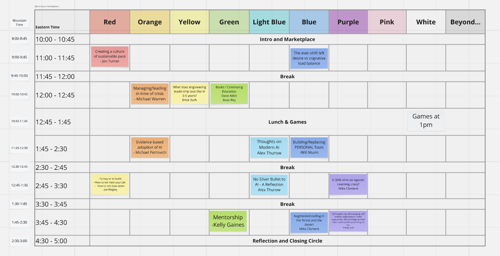
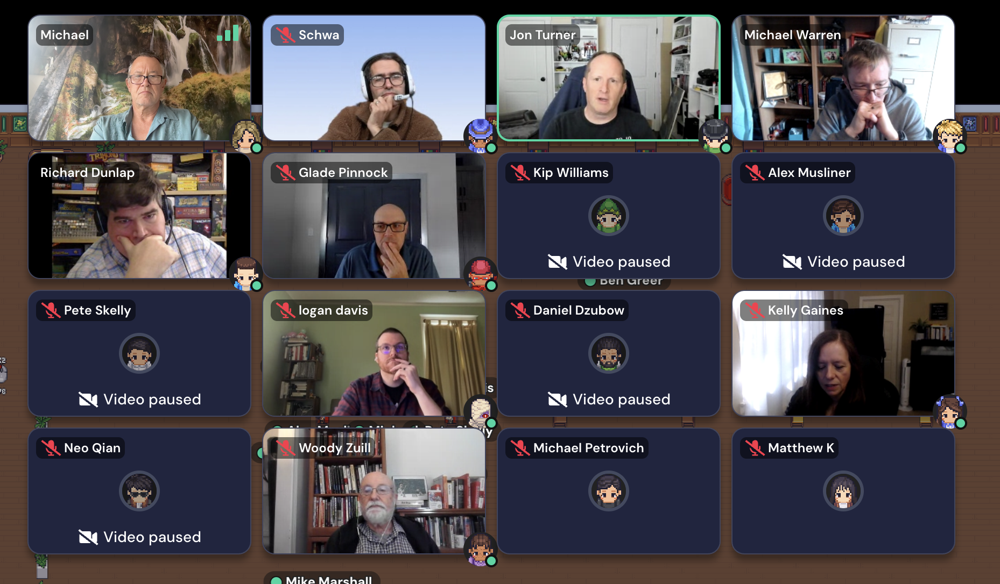
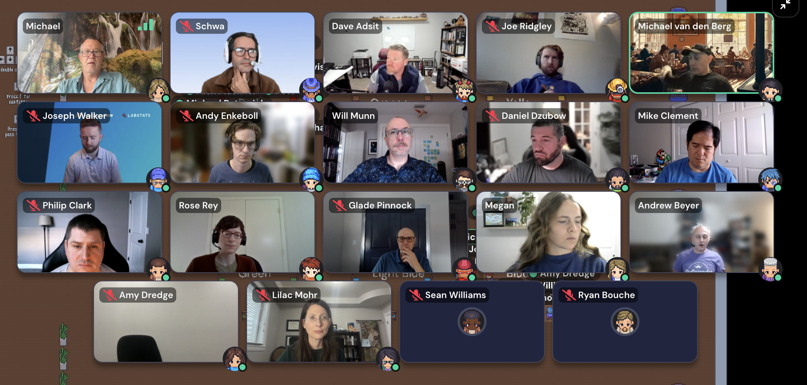

# Session Notes

11:07:56 - 

| Time (ET)   | Mountain    | Red                                                                                | Orange                                              | Yellow                                                              | Green                                                | Light Blue                                          | Blue                                                         | Purple                                                                                       | Pink | White        | Beyond |
|-------------|-------------|------------------------------------------------------------------------------------|-----------------------------------------------------|---------------------------------------------------------------------|------------------------------------------------------|-----------------------------------------------------|--------------------------------------------------------------|----------------------------------------------------------------------------------------------|------|--------------|--------|
| 10:00-10:45 | 8:00-8:45   | Intro and Marketplace (all tracks)                                                 |                                                     |                                                                     |                                                      |                                                     |                                                              |                                                                                              |      |              |        |
| 11:00-11:45 | 9:00-9:45   | Creating a culture of sustainable pace - Jon Turner                                |                                                     |                                                                     |                                                      |                                                     | The ever-shift left desire vs cognative load balance         |                                                                                              |      |              |        |
| 11:45-12:00 | 9:45-10:00  | Break (all tracks)                                                                 |                                                     |                                                                     |                                                      |                                                     |                                                              |                                                                                              |      |              |        |
| 12:00-12:45 | 10:00-10:45 |                                                                                    | Managing/leading in time of crisis - Michael Warren | What does engineering leadership look like in 3-5 years? Brice Ruth | Books / Continuing Education - Dave Adsit - Rose Rey |                                                     |                                                              |                                                                                              |      |              |        |
| 12:45-1:45  | 10:45-11:45 | Lunch & Games (all tracks)                                                         |                                                     |                                                                     |                                                      |                                                     |                                                              |                                                                                              |      | Games at 1pm |        |
| 1:45-2:30   | 11:45-12:30 |                                                                                    | Evidence-based adoption of AI - Michael Petrovich   |                                                                     |                                                      | Thoughts on Modern AI - Alex Thurow                 | Building/Replacing PERSONAL Tools - Will Munn                |                                                                                              |      |              |        |
| 2:30-2:45   | 12:30-12:45 | Break (all tracks)                                                                 |                                                     |                                                                     |                                                      |                                                     |                                                              |                                                                                              |      |              |        |
| 2:45-3:30   | 12:45-1:30  | To buy or to build - How is not hate your job - How to not slow down - Joe Ridgley |                                                     |                                                                     |                                                      | No Silver Bullet to AI - A Reflection - Alex Thurow |                                                              | Is 50% time on Agentic Learning crazy? - Mike Clement                                        |      |              |        |
| 3:30-3:45   | 1:30-1:45   | Break (all tracks)                                                                 |                                                     |                                                                     |                                                      |                                                     |                                                              |                                                                                              |      |              |        |
| 3:45-4:30   | 1:45-2:30   |                                                                                    |                                                     |                                                                     | Mentorship - Kelly Gaines                            |                                                     | Augmented coding in the forest and the desert - Mike Clement | Self-regulating, self-managing, self-directed organizations (partly illegible) - Woody Zuill |      |              |        |
| 4:30-5:00   | 2:30-3:00   | Reflection and Closing Circle (all tracks)                                         |                                                     |                                                                     |                                                      |                                                     |                                                              |                                                                                              |      |              |        |

Grid: <https://app.gather.town/app/5GMBVJOcKR5UhiT7/EL%20Summit>

## 10:00 - All tracks - no speaker listed

## 11:00 - Red - Jon Turner

11:02:21 - 

Names on the grid: Michael, Schwa, Jon Turner, Michael Warren, Richard Dunlap, Glade Pinnock, Kip Williams, Alex Musliner, Pete Skelly, logan davis, Daniel Dzubow, Kelly Gaines, Neo Qian, Woody Zuill, Michael Petrovich, and Matthew K. Partly visible labels at the edges: Ben Greer and Mike Marshall.

## 11:00 - Blue - no speaker listed

11:09:23 - 11:06 - I moved from Red to Blue session.

11:10:27 - 

11:13:50 - David Adsit - What is cargo cult of shift left?  Is there still a DBA?  Handoffs....  Shift left was attempt to address problem of handoff and context loss.  Embrace that there is always a bottleneck.

11:16:11 - Joseph Walker -- Has always been small group.  More hats, not more people/roles.

## 11:20 - Red - Jon Turner

11:20:49 - 11:20 Blue -> Red

11:33:59 - Michael Petrovich - There is no free lunch.

11:35:18 - Michael P - Set up for later talk.  What is the problem we're trying to solve.

11:39:38 - Alex Thurow - Culture of greed is multiplied by speed (of AI and old management practices)

11:39:43 - Schwa - Great concept -- Integrating at so many different time scales.

11:41:55 - logan davis - reference to 70s show.  We are swimming in whole new systems.  Ledgers.  Desks.  Phones.  -> Spreadsheets.  Zoom.

11:49:33 - Session ended in Red room.

## 12:00 - Orange - Michael Warren

## 12:00 - Yellow - Brice Ruth

## 12:00 - Green - Dave Adsit, Rose Rey
